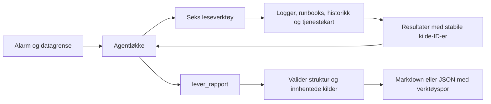

# Natteskiftet 🐺

En agent som undersøker driftsalarmer, finner belegg i logger og historikk, og leverer en norsk situasjonsrapport med fakta, hypoteser, usikkerhet og konkrete neste steg. Bygget på [startrepoet til Halloween-hackatonet](https://github.com/halloween-hackaton-2026/natteskiftet).

Alle seks dataverktøy er implementert. De leser oppgavens fiktive datasett; agenten kan ikke utføre driftstiltak eller kontakte noen. En strukturert sluttrapport godtas bare når kildehenvisningene finnes blant verktøyresultatene fra den aktuelle kjøringen.

## Kjør på ett minutt

Krever Node.js **20.12 eller nyere**. Kjør kommandoene fra prosjektmappen.

```bash
npm ci
npm test
npm run demo
```

Demoen virker også uten installerte pakker: `node src/index.js --demo --alle`. Den kjører ekte leseverktøy og rapportvalidering, men analysene er **kuratert referanse**, ikke modellgenererte svar. Ingen API-nøkkel, nettverk eller API-kostnad er nødvendig for demo og tester.

For en faktisk agentkjøring:

```bash
cp .env.example .env
# Legg ANTHROPIC_API_KEY i .env med en teksteditor.
npm start
npm start -- --alarm api-gateway
npm start -- "ALARM kl 03:40: api-gateway gir 17 % 504"
```

Modellmodus sender oppgaven og innhentede kildedata til Anthropic. Standardmodellen er `claude-sonnet-5-5`, som i startrepoet. `MODELL` kan overstyres i `.env`; modellen må støtte Messages API og verktøykall. API-nøkkelen må ha tilgang til valgt modell. `.env` skal aldri committes.

## Velg alarm og kunnskapstidspunkt

```bash
npm start -- --liste
npm start -- --alarm betaling
npm start -- --alarm innlogging --ved 03:05
npm start -- --alarm sok --ved 03:20
npm start -- --alle
```

`--alarm` godtar tjenestenavn eller alarm-ID. `--alle` gjør én separat analyse per alarm og kan derfor gjøre fem betalte modellkjøringer. `--help` viser alle valg.

Standardkjøringen er retrospektiv og bruker data frem til **29. oktober 2026 kl. 03:48:05 +01:00**, siste faktiske logglinje. Rapporten viser denne datagrensen. Kort tid som `03:05` tolkes som norsk tid denne natten; full ISO-tid må ha tidssone. Serverens lokale tidssone påvirker ikke tolkningen.

`--ved` filtrerer bort senere logger, deployer og alarmer. Runbooks og tidligere hendelser filtreres på tilgjengelige datoer. Tjenestekatalogen er udatert og har ingen historiske versjoner; post-mortem-data mangler publiseringstid. Disse begrensningene følger med i verktøyresultatene. `--ved` er derfor en tidsavgrensning av datasettet, ikke en full rekonstruksjon av hva organisasjonen visste på et historisk tidspunkt.

Det skillet er avgjørende: diskalarmen kl. 03:05 kan først bekreftes avklart etter loggen kl. **03:09:12**. Demoens ferdigskrevne analyser gjelder bare siste datagrense, så `--demo --ved` avvises.

## Rapporter og verktøyspor

```bash
npm start -- --demo --alarm varsling --ut rapport.md --spor spor.json
npm start -- --demo --alle --json --stille > alle.json
npm start -- --alarm api-gateway --ut gateway.md --spor gateway-spor.json
```

Rapporter skrives til stdout; fremdrift og synlige verktøykall til stderr. `--stille` skjuler fremdriften. JSON inneholder rapport, datagrense, modus, hentede kilder, verktøyspor og registrert tokenbruk. `--ut` og `--spor` oppretter nye filer og nekter å overskrive eksisterende filer. Målmappen må finnes.

Rapporten skiller observerte fakta fra hypoteser med kvalitativ sikkerhet, gir motbevis og kunnskapshull, og knytter hvert tiltak til ansvarlig og kontroll av effekt. Kildevedlegget viser de faktiske kildene; hele verktøysvar finnes i JSON-sporet. Kildekontrollen beviser at kilden er hentet, **ikke** at den semantisk beviser modellens påstand. Rapporten må fortsatt vurderes av vakten.

Exit-koder: `0` for ferdig rapport/demo/liste, `1` for ugyldige valg eller oppsett, `2` for ufullstendig modellanalyse, `130` ved Ctrl-C. En ufullstendig kjøring lagrer kildene i JSON, men utgir seg ikke for å ha en ferdig rapport.

## Hva de fem alarmene krever

| Alarm | Begrunnet vurdering | Viktig feilslutning å unngå |
| --- | --- | --- |
| Betaling 03:12 | Kodefeil etter 2.14.0 er sterkt støttet; anbefal vurdering av rollback og effektmåling. | En enkelt treg Kortnett-måling forklarer ikke de tidligere lokale TypeError-feilene. |
| Disk 03:05 | Loggrotasjon; denne alarmen er avklart fra 03:09:12. | Å slette logger eller erklære den avklart allerede 03:05. |
| Søk 03:20 | Fullindeks, heap-press og GC; hent fersk tilstand før eventuell pause. | Raske enkeltkall beviser ikke at p95 er normalisert. |
| SMS 03:31 | Timeout og 429; både leverandørtreghet og retry-forsterkning må undersøkes. | Å fastslå én rotårsak eller stole på en gammel grønn statusside. |
| Gateway 03:40 | Vedlikehold → sesjonslås → tilkoblingspress → innlogging → 504. | Å følge database-runbookens råd om en pgbouncer som er fjernet. |

[Detaljert referanse med tidslinjer og kilder](docs/fasit.md) beskriver hva dataene faktisk støtter. Dette er også grunnlaget for den kuraterte demoen.

## Oppbygning



| Verktøy | Hva det gir |
| --- | --- |
| `sok_i_logger` | Kombinerbare filtre, kronologiske resultater, eksplisitt avkorting og paginering. |
| `hent_runbook` | Dokumentasjon, oppdateringsdato og kilde. Filnavn velges fra en fast tillatt liste. |
| `sjekk_deploy_historikk` | Utrullinger og konfigendringer, nyest først, også eldre cron- og retry-endringer. |
| `finn_lignende_hendelser` | Tidligere hendelser med årsak og tiltak, som sammenligningsgrunnlag. |
| `hent_tjenesteinfo` | Eier, primær-/sekundærvakt og avhengigheter, med forbehold om udatert katalog. |
| `hent_alarmer` | Alarm-ID, tidspunkt, alvorlighet og tekst innen datagrensen. |

`lever_rapport` er et avsluttende, lokalt verktøykall for strukturell kontroll, ikke et driftstiltak. Modellen får feil tilbake ved ugyldig rapport og kan rette den innen gjenværende budsjett. Flere lesekall kan kjøre parallelt, og alle resultatene returneres i samme melding. Identiske søk gjenbrukes innen kjøringen. Verktøysvar behandles som kildedata; prompten avviser instruksjoner inne i logger og dokumenter.

```text
src/index.js             CLI, .env, alarmvalg, avbrudd og eksport
src/agent.js             Modellprotokoll, budsjetter, kildeinnsamling og cache
src/verktoy.js           Seks dataverktøy og undersøkelsesinstruksjoner
src/tid.js               Streng og tidssoneuavhengig tidsvalidering
src/rapport.js           Felles rapportskjema, validering og Markdown
src/demo.js              Tydelig merket kuratert demo via de ekte verktøyene
data/                    Uendrede fiktive oppgavedata
test/                    Verktøy-, agent-, rapport-, CLI- og scenariotester
test/fixtures/           Kuraterte referanseanalyser
docs/fasit.md            Begrunnet gjennomgang av alle fem alarmer
```

## Grenser og feilhåndtering

`.env` leses før modellkonfigurasjon og klientopprettelse, slik at også `MODELL` og `MAX_ITERASJONER` faktisk virker. Bare SDK-en krever en installert avhengighet; den lastes først i modellmodus.

| Miljøvariabel | Standard | Betydning |
| --- | --- | --- |
| `MAX_ITERASJONER` | 10 | Maks modellrunder; siste runde reserveres til rapport. |
| `MAX_VERKTOYKALL` | 40 | Maks etterspurte lesekall, inkludert feil og cache-treff. |
| `MAX_TOKENS` | 6000 | Maks utdata-tokens per API-kall. |
| `MAX_TOTAL_TOKENS` | 80000 | Stopper nye API-kall når registrert samlet tokenbruk når grensen. |
| `API_TIMEOUT_MS` | 45000 | Samlet ventetid per API-kall, inkludert SDK-retry. |
| `MAKS_VARIGHET_MS` | 180000 | Samlet tidsfrist for én modellanalyse. |

Tokenkontrollen er **ikke en hard kostnadsgrense**: et påbegynt kall kan overskride terskelen gjennom innsendt kontekst. SDK-en kan prøve en feilet forespørsel én gang innen tidsfristen. Tokenbruk fra mislykkede forespørsler er ikke nødvendigvis tilgjengelig. Bruk leverandørens kontogrenser for kontroll av faktiske kostnader.

Timeout, nettverks-/API-feil, avslag og avkuttede modellsvar gir ufullstendig resultat. Ufullstendige verktøykall fra `max_tokens` blir ikke utført. Ctrl-C avbryter videre arbeid; allerede sendt API-arbeid kan ha kostet tokens. API-feil gjengis uten rå forespørsler eller autentisering.

## Verifisering

```bash
npm test
npm run eval
npm run demo -- --stille
```

Testene bruker `node:test`, ekte oppgavedata og en injisert modellklient. De dekker blant annet tidsgrenser, DST-offset i historikken, paginering, ukjente felt, path traversal, samtidige verktøyresultater, rapportreparasjon, cache, avbrudd, tidsfrister, budsjetter, kilde-ID-er, `.env`-rekkefølge, JSON-eksport og alle fem referansescenarier. GitHub Actions kjører samme pakke på Node 20, 22 og 24.

`npm run eval` kontrollerer den **kuraterte referansen og verktøylaget**. Det er ikke en evaluering av kvaliteten på levende modellsvar. Modellintegrasjonen er både protokolltestet med kontrollerte svar og prøvd mot Anthropic med `claude-sonnet-5-5` 29. oktober 2026. Etter en innstramming av undersøkelsens omfang fullførte alle fem alarmene innen standardbudsjettene. Tre rapporter krevde automatisk reparasjon av ukjente skjemafelt. Dette er én gjennomkjøring, ikke et mål på stabil suksessrate.

Manuell kontroll fant riktige hovedspor, men også unøyaktigheter om eskaleringstid og første observasjon i filtrerte logger. Se [testresultater og begrensninger](docs/live-test.md). Lagre `--spor` og vurder rapporten mot kildene før driftstiltak.

API-implementasjonen følger [Messages API](https://platform.claude.com/docs/en/build-with-claude/working-with-messages) og [håndtering av stoppgrunner](https://platform.claude.com/docs/en/build-with-claude/handling-stop-reasons). I tråd med [Sonnet 5.5-integrasjonen](https://platform.claude.com/docs/en/models/sonnet-5-5/migration-guide) brukes automatisk verktøyvalg, uendret system-/verktøyprefiks og historikk som bare utvides. Budsjettbeskjeder legges til som nye meldinger; nye lesekall avvises lokalt når budsjettet er brukt opp. Modellnavn kan kontrolleres i [modelloversikten](https://platform.claude.com/docs/en/models/overview).
# hckathon26
